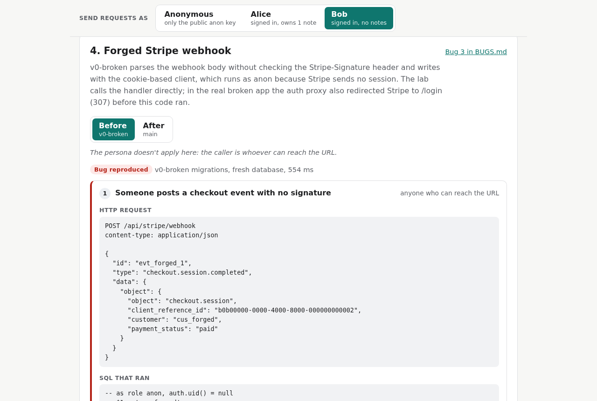

# Jotpad rescue: live lab

**Live:** https://sunnatulla-vibe-rescue.netlify.app (runs entirely in your browser; first load is about 5 MB)

A static page that replays four bugs from my
[Next.js + Supabase + Stripe rescue case study](https://github.com/atokim4/vibe-rescue-nextjs-supabase) against
the case study's real SQL migrations. Each bug has a Before / After toggle: Before loads the broken migrations (`v0-broken`),
After loads the fixed ones (`main`), and the same requests run against both. (The public case-study repo holds a
snapshot of the fixed version; the broken migration is kept here in `src/sql/before/`.)

Postgres runs in your browser ([PGlite](https://pglite.dev), Postgres compiled to WebAssembly) in a Web Worker.
There is no server, no Supabase project and no API key. This is a personal portfolio project, and all the data
is sample data (two made-up users, Alice and Bob).

## What it shows

| #   | Scenario                                             | Before (`v0-broken`)                                                          | After (`main`)                                                          |
| --- | ---------------------------------------------------- | ----------------------------------------------------------------------------- | ----------------------------------------------------------------------- |
| 1   | Bob (or anon) lists notes                            | Alice's note comes back                                                       | 0 rows                                                                  |
| 2   | Bob inserts a note owned by Alice                    | Accepted; it shows up on Alice's dashboard                                    | `42501 new row violates row-level security policy`                      |
| 3   | Bob adds a 4th note, then sets his own plan to `pro` | Both go through                                                               | 4th note refused by the insert policy; the update matches 0 rows        |
| 4   | POST to the Stripe webhook handler                   | Forged events get 200; a real, signed payment updates 0 rows (runs as `anon`) | No / bad signature: 400 with no SQL; signed payment: 200, Bob is on Pro |

Each step shows the client call (or HTTP request), the SQL that reached Postgres with the role and `auth.uid()`
it ran as, and the result. A persona switch (anonymous, Alice, Bob) re-runs scenarios 1 to 3 as that user.



More in [docs/screenshots](docs/screenshots): each scenario before and after, and the page on a phone in dark mode.

## How it works

- **The SQL is the case study's, unchanged.** `src/sql/` holds the Supabase stand-in from the case study's test
  suite (`anon` / `authenticated` / `service_role` roles, `auth.users`, `auth.uid()` reading
  `request.jwt.claims`) and the migrations of both versions, already copied into this repo; `src/sql/SOURCE.md` records where each file
  came from. (`scripts/sync-sql.mjs` is the script that copied them from my local working copy of the case
  study, which has the full history; the public snapshot repo doesn't, so you don't need it to run the lab.)
- **Requests run the way PostgREST runs them**: one transaction per request, `set_config('request.jwt.claims', …)`
  and `set local role …`, then the query. So RLS policies, the signup trigger and the `security definer` paywall
  function behave as they do on Supabase. PostgREST itself and Supabase Auth are not emulated: the lab sends the
  SQL that the client call turns into.
- **The webhook handlers are ports** of `src/app/api/stripe/webhook/route.ts` at both refs, with the same
  branches and status codes. The fixed one checks Stripe's signature scheme (`t=…,v1=…`, HMAC-SHA256 over
  `"<t>.<raw body>"`, 5-minute tolerance) with Web Crypto. A test checks it against the Stripe SDK in both
  directions. The secret is a made-up test value and nothing talks to Stripe.
- **Every run starts from a fresh database.** The worker builds each version once from the migrations, then
  clones it per run (about 0.5 s instead of 2 to 3 s), so runs never see each other's writes.

What the lab leaves out: bug 1 (auth redirect loop), bug 4 (env vars on deploy) and bug 5 (loading and error
states) are about the Next.js app, not the database, so they are only in the case study. In the real broken
app, bug 3 also showed up as a 307 redirect to /login for Stripe's request; the lab calls the handler directly.

## Run it

Node 22 or newer.

```bash
npm install
npm run dev        # http://localhost:5173
npm test           # Vitest: every scenario before and after, webhook branches, signature vs the Stripe SDK
npm run check      # typecheck, lint, format check, tests, production build
npm run e2e        # after a build: headless Chrome flips every toggle, saves docs/screenshots/
```

No environment variables are needed. `npm run build` writes a static site to `dist/` that any static host can
serve (it uses relative paths, so a subfolder works too). The PGlite WebAssembly and data files make it about
16 MB, about 5 MB gzipped, and they load once per visit.

## Layout

```
src/sql/                  copied from the case study (do not edit; see SOURCE.md)
src/engine/database.ts    PGlite + shim + migrations + sample data; runs SQL as a persona
src/engine/scenarios.ts   the four scenarios, shared by the UI and the tests
src/engine/webhook.ts     the broken and fixed webhook handlers
src/engine/stripe-signature.ts  Stripe-Signature check with Web Crypto
src/worker.ts             Web Worker that owns Postgres
src/main.ts, src/ui/      the page (plain TypeScript and DOM, no framework)
test/                     Vitest
e2e/run.mjs               browser run (playwright-core + an installed Chrome; set CHROME_PATH)
scripts/sync-sql.mjs      copied the SQL from the case study's full-history working copy (not needed to run)
```

## Stack

TypeScript, Vite, PGlite 0.5 (Postgres 18 in WebAssembly), Web Crypto, Vitest, ESLint, Prettier.

## License

MIT. Written by Sunnatulla E. as a personal project.
